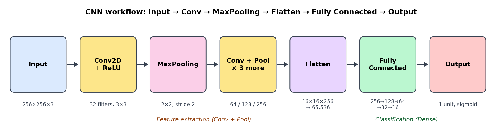
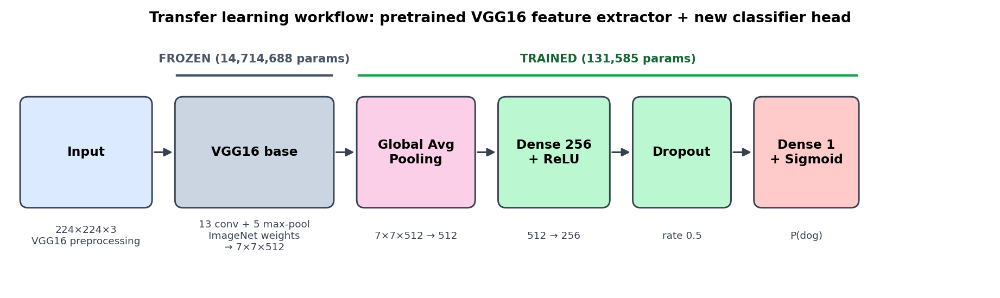
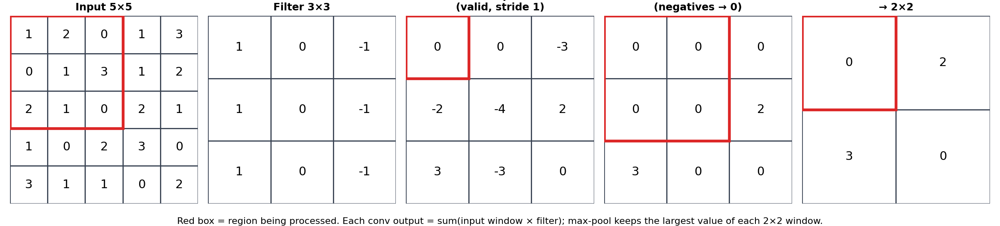
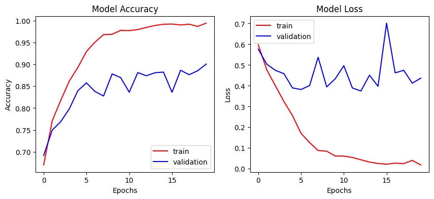
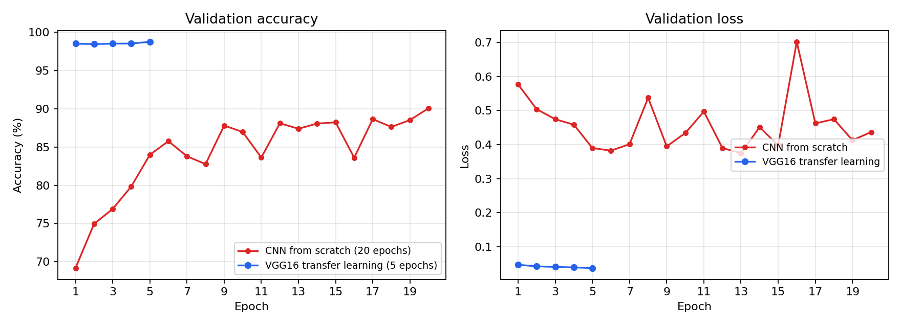
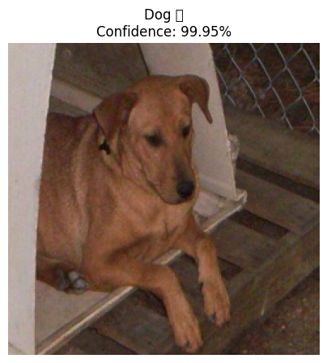

# Dogs vs Cats Image Classification: CNN from Scratch vs Transfer Learning (VGG16)

A comprehensive deep learning project implemented in TensorFlow/Keras that classifies images as **cat** or **dog**. This project explores two distinct paradigms:
1. **Custom CNN from Scratch:** Building a multi-layer convolutional network from the ground up, with an in-depth walkthrough of CNN mechanisms (convolution, padding, pooling, flattening, and backpropagation).
2. **Transfer Learning with Pretrained VGG16:** Leveraging representations learned on 1.28 million ImageNet images to dramatically cut training time and slash error rates.

[](https://colab.research.google.com/github/<your-username>/<repo-name>/blob/main/CNN_mini_project.ipynb)
[](https://colab.research.google.com/github/<your-username>/<repo-name>/blob/main/transfer_learning.ipynb)


---

## Table of Contents

1. [Project Overview](#project-overview)
2. [Workflows](#workflows)
   - [Custom CNN Workflow](#custom-cnn-workflow)
   - [Transfer Learning Workflow](#transfer-learning-workflow)
3. [Core CNN Concepts](#core-cnn-concepts)
   - [1. Convolution](#1-convolution)
   - [2. Padding](#2-padding)
   - [3. Pooling](#3-pooling)
   - [4. Feature Aggregation: Flatten vs Global Average Pooling](#4-feature-aggregation-flatten-vs-global-average-pooling)
   - [5. Output Layer & Loss](#5-output-layer--loss)
   - [6. Backpropagation in a CNN](#6-backpropagation-in-a-cnn)
4. [Model Architectures](#model-architectures)
   - [Custom CNN Architecture](#custom-cnn-architecture)
   - [Transfer Learning (VGG16) Architecture](#transfer-learning-vgg16-architecture)
5. [Results & Comparative Analysis](#results--comparative-analysis)
   - [Custom CNN Performance](#custom-cnn-performance)
   - [Transfer Learning Performance](#transfer-learning-performance)
   - [Head-to-Head Comparison](#head-to-head-comparison)
6. [Inference & Sample Prediction](#inference--sample-prediction)
7. [Project Structure](#project-structure)
8. [How to Run](#how-to-run)
9. [Key Insights & Future Work](#key-insights--future-work)

---

## Project Overview

| Property | Custom CNN (From Scratch) | Transfer Learning (VGG16) |
|---|---|---|
| **Primary Goal** | Educational understanding of CNN mechanics | High performance & robust generalization |
| **Dataset** | [Dogs vs Cats on Kaggle](https://www.kaggle.com/datasets/salader/dogsvscats) (`salader/dogsvscats`) | Same dataset |
| **Data Split** | 20,000 train / 5,000 validation | 20,000 train / 5,000 validation |
| **Input Dimensions** | 256 × 256 × 3, scaled to [0, 1] | 224 × 224 × 3, VGG16 `preprocess_input` |
| **Base Model** | None (4 custom conv blocks) | Pretrained VGG16 (ImageNet, frozen) |
| **Feature Aggregation** | `Flatten` (65,536 units) | `GlobalAveragePooling2D` (512 units) |
| **Total Parameters** | 17,213,505 | 14,846,273 |
| **Trainable Parameters** | 17,213,505 (100%) | 131,585 (0.89%) |
| **Training Epochs** | 20 | 5 |
| **Validation Accuracy** | **90.06%** | **98.74%** |
| **Validation Loss** | 0.4366 | **0.0371** |

---

## Workflows

### Custom CNN Workflow

In the from-scratch model, feature extraction filters and classifier weights are initialized randomly and learned simultaneously from the training images.



```
Input (256x256x3) -> [Conv2D + BatchNorm + MaxPool] x4 -> Flatten -> Dense (256..16) -> Sigmoid Output
```

| Stage | Role | Implementation in Custom CNN |
|---|---|---|
| **Input** | Receives RGB images | 256 × 256 × 3, normalized to [0, 1] |
| **Convolution** | Learns local visual filters (edges, textures, shapes) | 4 `Conv2D` layers (32 → 64 → 128 → 256 filters), 3×3 kernels, ReLU |
| **Pooling** | Down-samples spatial dimensions; translation invariance | 2×2 window, stride 2 `MaxPooling2D` after every conv block |
| **Flatten** | Serializes 3D feature maps to a 1D vector | 16 × 16 × 256 → 65,536 values |
| **Classifier** | High-level decision making | Fully connected layers: 256 → 128 → 64 → 32 → 16 |
| **Output** | Binary prediction | 1 neuron with Sigmoid activation ($p \ge 0.5 \implies$ Dog) |

---

### Transfer Learning Workflow

Transfer learning freezes the feature extraction layers of a model pretrained on a large corpus (ImageNet, 1.28 million images, 1,000 categories) and trains only a lightweight classification head.



```
Input (224x224x3) -> Pretrained VGG16 Base (Frozen) -> GlobalAvgPool -> Dense (256) -> Dropout (0.5) -> Sigmoid Output
```

- **Frozen Base (14,714,688 params):** 13 convolutional layers and 5 max-pooling layers loaded with ImageNet weights. The weights are fixed (`trainable = False`), ensuring rich representations (edges, textures, ears, eyes, snouts) are retained without corruption.
- **Trained Classification Head (131,585 params):**
  1. `GlobalAveragePooling2D`: Collapses each 7 × 7 feature map into a single average value (512 total), dramatically reducing parameter count.
  2. `Dense(256, activation='relu')`: Maps extracted features to cat/dog distinction.
  3. `Dropout(0.5)`: Prevents co-adaptation and overfitting.
  4. `Dense(1, activation='sigmoid')`: Outputs probability of the image being a dog.

---

## Core CNN Concepts

### 1. Convolution

A convolutional layer applies a set of small learnable filters (kernels) across the input. At every position, the filter performs an element-wise dot product with the underlying receptive field and sums the results to generate a **feature map**.



In the example above, a 3×3 vertical edge detector computes its top-left output:

```
window = [[1, 2, 0],      filter = [[ 1, 0, -1],
          [0, 1, 3],                [ 1, 0, -1],
          [2, 1, 0]]                [ 1, 0, -1]]

(1·1 + 2·0 + 0·-1) + (0·1 + 1·0 + 3·-1) + (2·1 + 1·0 + 0·-1) = 1 - 3 + 2 = 0
```

- **Weight Sharing:** The same filter matrix scans across the entire input, drastically reducing parameters compared to fully connected layers.
- **Local Connectivity:** Each neuron connects only to a localized spatial region.
- **Receptive Field Hierarchy:** Shallow layers capture low-level features (edges, color gradients); deeper layers capture complex object semantics (faces, ears, limbs).
- **Spatial Output Formula:**

  $$O = \left\lfloor \frac{N + 2P - F}{S} \right\rfloor + 1$$

  where $N$ is input dimension, $F$ is filter size, $P$ is padding, and $S$ is stride.

### 2. Padding

Without padding, convolutions systematically shrink the spatial dimensions and under-sample border pixels.

| Type | Keras Option | Behavior | Dimension Effect ($N=256, F=3, S=1$) |
|---|---|---|---|
| **Valid** | `padding='valid'` | No zero-padding added; boundary pixels discarded | $256 - 3 + 1 =$ **254** |
| **Same** | `padding='same'` | Zeros added symmetrically so output matches input size | **256** |

### 3. Pooling

Pooling layers down-sample feature maps independently across channels:
- Reduces spatial dimension and computational load.
- Provides translation and perturbation invariance.
- Introduces **no learnable parameters**.

With 2×2 max pooling and stride 2, spatial dimensions halve at each stage (e.g., $256 \to 128 \to 63 \to 32 \to 16$).

### 4. Feature Aggregation: Flatten vs Global Average Pooling

| Technique | Used In | How it works | Dimensionality | Trainable Parameters in Next Dense Layer |
|---|---|---|---|---|
| **Flatten** | Custom CNN | Unrolls 3D feature tensor into a 1D vector | $16 \times 16 \times 256 = 65,536$ | $65,536 \times 256 + 256 = \mathbf{16,777,472}$ (~97% of model!) |
| **GlobalAveragePooling2D** | Transfer Learning | Takes spatial mean across each feature map | $7 \times 7 \times 512 \to \mathbf{512}$ | $512 \times 256 + 256 = \mathbf{131,328}$ (99.2% reduction!) |

> Replacing `Flatten` with `GlobalAveragePooling2D` prevents massive parameter bloat, drastically reduces overfitting, and preserves spatial semantic density.

### 5. Output Layer & Loss

For binary classification, a single output neuron with **Sigmoid** activation yields the dog probability:

$$p = \sigma(z) = \frac{1}{1 + e^{-z}}$$

The objective is optimized with **Binary Cross-Entropy (BCE)** loss:

$$\mathcal{L} = -\big[\,y\log(p) + (1-y)\log(1-p)\,\big]$$

where $y \in \{0, 1\}$ (0 for cat, 1 for dog) and $p \in (0, 1)$.

### 6. Backpropagation in a CNN

1. **Forward Pass:** Input data propagates through conv, pooling, aggregation, and dense layers to yield prediction $p$ and loss $\mathcal{L}$.
2. **Backward Pass:** Error gradients $\frac{\partial \mathcal{L}}{\partial w}$ flow backwards using the chain rule:
   - **Sigmoid + BCE:** Simplifies at output pre-activation to $\delta = p - y$.
   - **Dense:** $\frac{\partial \mathcal{L}}{\partial W} = a^T \delta$.
   - **MaxPooling:** Gradients route strictly to the spatial index holding the maximum activation; all other entries receive 0.
   - **ReLU:** Passes gradient unmodified if input $> 0$, otherwise gates to 0.
   - **Convolution:** Gradients from all spatial positions are summed across shared filter weights.

---

## Model Architectures

### Custom CNN Architecture

Built from scratch with 4 convolutional blocks followed by Batch Normalization and 5 dense layers:

| Layer (type) | Output Shape | Param # | Notes |
|---|---|---|---|
| **Input** | `(None, 256, 256, 3)` | 0 | Scaled to $[0, 1]$ |
| `Conv2D (32, 3x3, same)` + `BatchNorm` | `(None, 256, 256, 32)` | 1,024 | Low-level feature extraction |
| `MaxPooling2D (2x2)` | `(None, 128, 128, 32)` | 0 | Spatial halving |
| `Conv2D (64, 3x3, valid)` + `BatchNorm` | `(None, 126, 126, 64)` | 18,752 | Intermediate patterns |
| `MaxPooling2D (2x2)` | `(None, 63, 63, 64)` | 0 | Spatial halving |
| `Conv2D (128, 3x3, same)` + `BatchNorm` | `(None, 63, 63, 128)` | 74,368 | Texture & shape detectors |
| `MaxPooling2D (2x2)` | `(None, 32, 32, 128)` | 0 | Spatial halving |
| `Conv2D (256, 3x3, same)` + `BatchNorm` | `(None, 32, 32, 256)` | 296,192 | High-level semantic features |
| `MaxPooling2D (2x2)` | `(None, 16, 16, 256)` | 0 | Final spatial pooling |
| `Flatten` | `(None, 65536)` | 0 | Serialized feature map |
| `Dense (256)` + `BatchNorm` | `(None, 256)` | 16,778,496 | Feature combination (parameter heavy) |
| `Dense (128)` + `BatchNorm` | `(None, 128)` | 33,408 | Compression |
| `Dense (64)` + `BatchNorm` | `(None, 64)` | 8,512 | Compression |
| `Dense (32)` + `BatchNorm` | `(None, 32)` | 2,208 | Compression |
| `Dense (16)` | `(None, 16)` | 528 | Compression |
| `Dense (1, sigmoid)` | `(None, 1)` | 17 | Final classification |
| **Total Parameters** | | **17,213,505** | Trainable: 17,213,505 (100%) |

---

### Transfer Learning (VGG16) Architecture

Reuses pretrained VGG16 with a custom classification head:

| Layer (type) | Output Shape | Param # | Status / Details |
|---|---|---|---|
| **Input** | `(None, 224, 224, 3)` | 0 | VGG16 ImageNet preprocessing |
| `vgg16 (Functional)` | `(None, 7, 7, 512)` | 14,714,688 | **Frozen** (ImageNet weights) |
| `GlobalAveragePooling2D` | `(None, 512)` | 0 | Channel-wise spatial mean |
| `Dense (256, relu)` | `(None, 256)` | 131,328 | **Trainable** head |
| `Dropout (0.5)` | `(None, 256)` | 0 | Regularization |
| `Dense (1, sigmoid)` | `(None, 1)` | 257 | **Trainable** output neuron |
| **Total Parameters** | | **14,846,273** | **56.63 MB** |
| **Trainable Parameters** | | **131,585** | **514.00 KB (0.89%)** |
| **Non-Trainable Parameters** | | **14,714,688** | 56.13 MB |

---

## Results & Comparative Analysis

### Custom CNN Performance

Trained for 20 epochs with batch size 32 using Adam optimizer:



- **Training Accuracy:** Reaches **99.40%** with training loss down to **0.0186**.
- **Validation Accuracy:** Peaked at **90.06%** at epoch 20, but demonstrated high variance (swinging down to **83.6%** at epoch 16).
- **Overfitting Diagnosis:** Validation loss bottomed out around epoch 13 (~0.375) and degraded to **0.4366** by epoch 20 while training loss continued downward. The large dense layer after `Flatten` memorized training samples.

---

### Transfer Learning Performance

Trained for only 5 epochs with batch size 32, Adam ($\text{lr} = 10^{-4}$):

| Epoch | Train Accuracy | Train Loss | Validation Accuracy | Validation Loss |
|:---:|:---:|:---:|:---:|:---:|
| 1 | 98.08% | 0.0580 | 98.50% | 0.0468 |
| 2 | 98.39% | 0.0460 | 98.44% | 0.0422 |
| 3 | 98.44% | 0.0455 | 98.50% | 0.0404 |
| 4 | 98.63% | 0.0379 | 98.52% | 0.0390 |
| **5** | **98.90%** | **0.0308** | **98.74%** | **0.0371** |

- **Instant High Accuracy:** Already **98.50%** validation accuracy after the very first epoch.
- **Zero Overfitting Gap:** Training accuracy (98.90%) and validation accuracy (98.74%) track within 0.16 percentage points.
- **Monotonic Loss Reduction:** Validation loss smoothly drops from 0.0468 to **0.0371**.

---

### Head-to-Head Comparison

The validation metrics highlight the contrast between training from scratch and using transfer learning:



| Aspect | Custom CNN (From Scratch) | VGG16 Transfer Learning | Difference / Advantage |
|---|---|---|---|
| **Best Val Accuracy** | 90.06% | **98.74%** | **+8.68% accuracy** (~73% relative error reduction) |
| **Best Val Loss** | 0.3748 (final: 0.4366) | **0.0371** | **>11× lower validation loss** |
| **Epochs Needed** | 20 epochs | **5 epochs** | **4× fewer epochs** |
| **Convergence Rate** | Slow (starts at 69.2%) | Fast (starts at **98.50%**) | Pretrained filters eliminate feature discovery phase |
| **Training Stability** | High volatility (fluctuates ±7%) | Exceptionally stable ($\le 0.3\%$ variance) | Smooth optimization surface |
| **Trainable Weights** | 17,213,505 | **131,585** | **130× fewer weights to optimize** |
| **Overfitting Resistance** | Poor (large gap between train/val) | Outstanding (train and val curves closely match) | Frozen base cannot overfit |

---

## Inference & Sample Prediction

Both notebooks include an end-to-end inference function `predict(image_path)` that handles preprocessing, loads the image, executes the forward pass, and plots the image alongside the classification label and confidence score.



```python
# Prediction function in Transfer Learning notebook
def predict(image_path):
    img = cv2.imread(image_path)
    img = cv2.cvtColor(img, cv2.COLOR_BGR2RGB)
    img_resized = cv2.resize(img, (224, 224))
    
    # Preprocessing matching VGG16 requirements
    x = preprocess_input(img_resized.astype(np.float32))
    x = np.expand_dims(x, axis=0)
    
    prob = float(model.predict(x, verbose=0)[0][0])
    label = "Dog" if prob >= 0.5 else "Cat"
    confidence = prob if prob >= 0.5 else 1.0 - prob
    
    print(f"Prediction: {label} ({confidence * 100:.2f}%)")
```

---

## Project Structure

```
cnn-mini-project/
├── assets/
│   ├── cnn_workflow.png               # Custom CNN pipeline diagram
│   ├── conv_pool_example.png          # Numerical example of convolution & pooling
│   ├── model_comparison.png           # Accuracy and loss curves comparing both models
│   ├── sample_prediction.png          # Inference output on sample test image
│   ├── training_curves.png            # Custom CNN training curves (overfitting illustration)
│   └── transfer_learning_workflow.png # Pretrained VGG16 + head workflow diagram
├── CNN_mini_project.ipynb             # From-scratch CNN: architecture, training, analysis
├── transfer_learning.ipynb            # Transfer learning with VGG16 & GAP head
├── requirements.txt                   # Environment dependencies
├── .gitignore                         # Git exclusion rules
└── README.md                          # Project documentation
```

---

## How to Run

### Option 1: Google Colab (Recommended)

1. Open either notebook directly in Colab:
   - [Run Custom CNN in Colab](https://colab.research.google.com/github/<your-username>/<repo-name>/blob/main/CNN_mini_project.ipynb)
   - [Run Transfer Learning in Colab](https://colab.research.google.com/github/<your-username>/<repo-name>/blob/main/transfer_learning.ipynb)
2. In Colab, navigate to **Runtime** → **Change runtime type** and select **T4 GPU**.
3. Obtain your `kaggle.json` API token from [Kaggle](https://www.kaggle.com/settings) (*Settings* → *Create New Token*).
4. Run the notebook cells sequentially; upload `kaggle.json` when prompted to automatically download and extract the dataset.

### Option 2: Local Environment

```bash
# Clone repository
git clone https://github.com/<your-username>/<repo-name>.git
cd <repo-name>

# Install required dependencies
pip install -r requirements.txt

# Download Kaggle dataset (place kaggle.json in ~/.kaggle/)
kaggle datasets download -d salader/dogsvscats
unzip -q dogsvscats.zip
```

> **Note:** The notebooks use Colab-specific paths (`/content/...`). When executing locally, adjust paths to reference your local dataset directory.

---

## Key Insights & Future Work

### Why Transfer Learning Outperformed Custom CNN
1. **Representational Power:** VGG16 was trained on ImageNet across 1,000 diverse classes, capturing general edge, corner, texture, and animal-part filters that directly transfer to cat vs dog discrimination.
2. **Global Average Pooling vs Flatten:** Replacing 65k unrolled activations with 512 average-pooled channels eliminated 16.6 million redundant weights, preventing memorization.
3. **Training Efficiency:** Reached 98.74% accuracy in 5 epochs (~10 minutes on T4 GPU) versus 90.06% across 20 epochs (~22 minutes) for the from-scratch network.

### Potential Extensions
- [x] Implement Transfer Learning with pretrained backbone (VGG16)
- [ ] **Fine-Tuning:** Unfreeze the top block of VGG16 (`block5_conv1`, `block5_conv2`, `block5_conv3`) and train with a very low learning rate ($10^{-5}$) to push accuracy past 99%.
- [ ] **Data Augmentation:** Introduce random rotations, horizontal flips, and zooms to boost robustness against unusual poses.
- [ ] **Modern Backbones:** Benchmark against lightweight, high-efficiency architectures such as MobileNetV3, EfficientNetV2, or ConvNeXt.
- [ ] **Deployment:** Export model to ONNX or TensorFlow Lite for fast real-time inference on edge or web apps.
